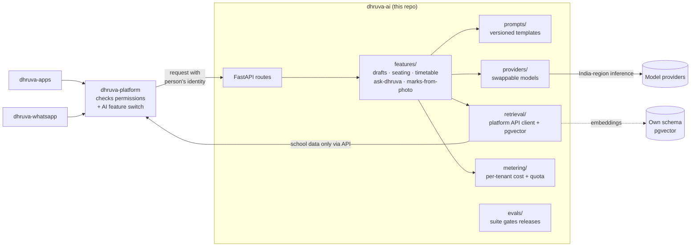

# dhruva-ai

The **Dhruva AI service** (Python, FastAPI). It answers questions from school records with sources, drafts content for people to approve, reads marks from photos, and generates timetables, exam seating and invigilation duties.

| | |
|---|---|
| Stack | Python 3.12, FastAPI, pydantic, swappable model providers, pgvector (retrieval), OR-Tools (timetable and seating) |
| Needed from | MVP (Oct–Dec 2026) |
| Runs as | Its own container service, scaled separately from the platform, with its own small schema and database role |
| Design docs | [Repositories and Technology Stack](https://github.com/Dhruva-One/dhruva-docs/blob/main/Technology/DhruvaOne%20Repositories%20and%20Technology%20Stack.md) · [Technical Architecture](https://github.com/Dhruva-One/dhruva-docs/blob/main/Technology/DhruvaOne-Technical-Architecture.md) |

## Purpose

- **Ask Dhruva:** grounded answers from records, always with the source.
- **Drafts:** notices, question papers, lesson plans, remedial suggestions and payroll checks. Dhruva drafts and a person approves.
- **Marks from photos:** read a snapped mark sheet or register.
- **Optimisation:** AI timetable, exam seating and invigilation duties (OR-Tools).
- **Voice and translation:** English and Hindi first, regional languages in Phase 1.
- **Evaluations and cost metering:** every prompt or model change passes the eval suite, and spend is capped per tenant.

It is kept separate from the platform because it uses a different language and ecosystem, scales on its own, carries its own spend and must keep inference in India.

## High-level architecture



### Rules this service follows

| Rule | How |
|---|---|
| Never the only way to do a task | Every feature has a manual path in the apps. When a provider fails or the budget is spent, the API returns an error the app treats as "do it by hand" (429 or 503), and the platform can switch AI off per tenant, campus, role or date. |
| No direct reads of school data | `app/retrieval/platform_client.py` calls the platform API with the caller's token. This service cannot read platform tables; it has its own schema for embeddings and usage. |
| Dhruva drafts, a person approves | Every draft response carries `needs_approval: true`. |
| India-region inference | Prompts with student or staff data go only to providers running in an India region (XCT-NFR-008, AI 5.7). `INFERENCE_REGION` is reported on `/health`. |
| Cheapest model that passes | Providers are swappable (`app/providers/registry.py`); the eval suite (`app/evals`) decides. |
| Cost metering and quotas | `app/metering/meter.py` records spend per tenant and capability and enforces a daily budget. |
| Shed first under load | AI is tier 2 in the load-shedding plan, so the platform sheds it before attendance or transport. |

## Repository layout

| Path | Purpose |
|---|---|
| `app/main.py` | FastAPI app and routes |
| `app/config.py` | Settings from the environment or `.env` |
| `app/features/` | One module per capability (`drafts.py` and `seating.py` are working examples) |
| `app/providers/` | `ModelProvider` interface, registry and an offline `fake` provider |
| `app/prompts/` | Versioned prompt templates (`templates/<name>.v<N>.txt`) |
| `app/retrieval/` | Platform API client; pgvector retrieval to follow |
| `app/metering/` | Per-tenant cost metering and budgets |
| `app/evals/` | Evaluation harness and cases |
| `tests/` | Unit and API tests |
| `spec/endpoints.json`, `app/spec_stubs.py` | The 34 AI-service APIs from the functional spec (one per AI capability flag plus ask, drafts, timetable, OCR, voice, translate, evals); each answers 501 until built |
| `Dockerfile` | Container image |

## Run it locally

**Prerequisites:** Python 3.11 or later (3.12 recommended, see `.python-version`). No model API keys are needed: the default `fake` provider runs offline.

```bash
python -m venv .venv
source .venv/bin/activate          # Windows: .venv\Scripts\activate
pip install -e ".[dev]"
cp .env.example .env

uvicorn app.main:app --reload --port 8000
```

Check it works:

```bash
curl localhost:8000/health
# {"status":"ok","service":"dhruva-ai","provider":"fake","region":"ap-south-1"}

curl -X POST localhost:8000/v1/drafts/notice -H 'content-type: application/json' \
  -d '{"tenant_id":"t1","audience":"Parents of Class 10","facts":["PTM on Saturday 7 November"]}'

curl -X POST localhost:8000/v1/exams/seating -H 'content-type: application/json' \
  -d '{"students":{"s1":"10A","s2":"10A","s3":"10B","s4":"10B"},"rows":1,"seats_per_row":4}'
```

Interactive API docs: <http://localhost:8000/docs>. The `spec stubs` group lists every AI API the spec needs; `GET /internal/spec/coverage` shows how many are built.

The catalog is generated in `dhruva-platform` (`npm run spec:sync`); copy `spec/services/ai-endpoints.json` here as `spec/endpoints.json` when it changes.

Tests, lint and evals:

```bash
pytest
ruff check .
python -m app.evals.run
```

With Docker:

```bash
docker build -t dhruva-ai .
docker run --rm -p 8000:8000 --env-file .env dhruva-ai
```

To work against a local platform, run `dhruva-platform` on port 3000 (the default `PLATFORM_API_URL`).

## Open decisions (from the Technology doc)

- Model provider and India-region availability: verify before the AI build starts.
- OCR provider and accuracy on Hindi handwriting for marks from photos: decide after a pilot on real mark sheets.

## Related repositories

`dhruva-platform` · `dhruva-apps` · `dhruva-site` · `dhruva-infra` · `dhruva-whatsapp` · `dhruva-connectors`, all in the [Dhruva-One](https://github.com/Dhruva-One) organisation.
